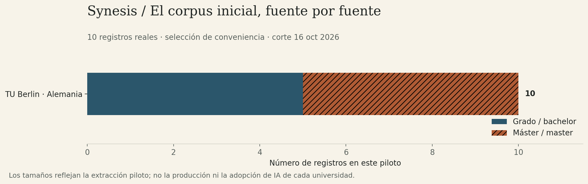
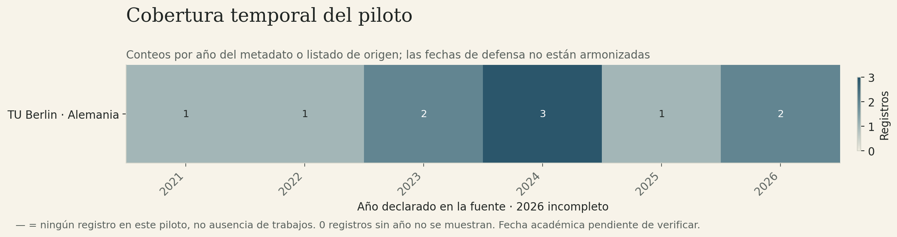
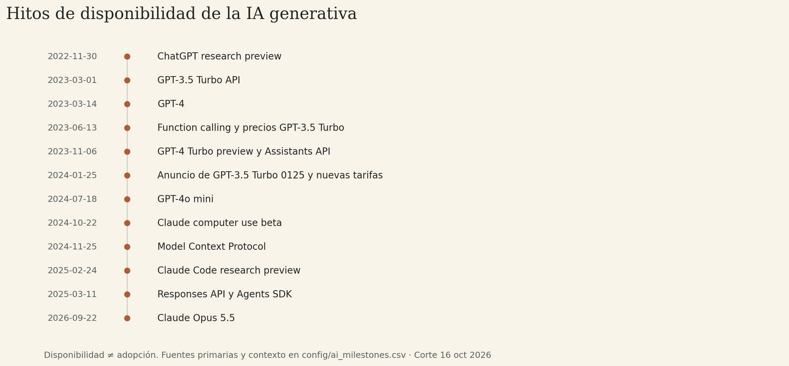
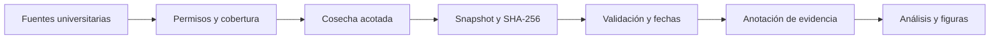

<p align="right"><strong>ES</strong> · <a href="README.en.md">EN</a></p>


# Synesis

**v0.1.0 · protocolo y piloto real · [Repositorio público](https://github.com/marcosdeaza/Synesis)**

Investigación reproducible sobre TFG, TFM y equivalentes universitarios alrededor de la difusión de la IA generativa. El foco es Valencia; la **Universidad Europea de Valencia es obligatoria** en el diseño, junto a UPV y comparadores nacionales e internacionales.

Esta es la **distribución pública minimizada**: la auditoría local de origen examinó **225 registros reales**; aquí se distribuyen **10 registros de metadatos con CC0-1.0 y evidencia verificable**, actualmente de TU Berlin. Son una muestra de conveniencia para probar procedencia y reproducción, sin estimaciones de adopción ni efectos causales.

UEV está presente en el registro institucional, el protocolo y el estudio local. **Sus registros no se redistribuyen todavía**: sus permisos de publicación de metadatos requieren revisión. Lo mismo ocurre con los demás registros excluidos. Los documentos de auditoría describen históricamente la muestra local; los informes de `reports/` se recalculan exclusivamente con las 10 filas distribuidas. Consulta el [alcance de esta variante](docs/PUBLICACION.md).

## Qué estudia Synesis

Dos líneas separadas: cambios observables en temas, métodos y referencias, y evidencia explícita de uso declarado de IA. Las fechas de lanzamiento describen disponibilidad tecnológica; su relación con las prácticas académicas debe investigarse con cobertura, fechas y anotación verificadas.

## Leer y continuar

- [Protocolo científico](docs/PROTOCOLO.md) y [plan de análisis](docs/PLAN_ANALISIS.md).
- [Fuentes y permisos](docs/FUENTES.md), [auditoría de España](docs/FUENTES_ESPANA.md) y [auditoría internacional](docs/FUENTES_GLOBALES.md).
- [Continuidad de la versión pública](CONTEXTO_PUBLICO.md) y [cronología](docs/CRONOLOGIA.md).
- [Informe reproducido de esta distribución](reports/PILOTO.md) y [derechos por capa](RIGHTS.md).

La memoria completa local no se copia. `CONTEXTO.md` en esta variante enlaza a la continuidad pública documentada arriba.





## Hitos y pipeline





## Reproducir sin red

Python 3.11 o posterior; el pipeline y las pruebas usan únicamente la biblioteca estándar:

```sh
make reproduce
```

Entrada: `data/pilot/rights_cleared.jsonl`. Salidas: `reports/`, reconstruidas localmente. Los fixtures sintéticos de las pruebas comprueban el software; nunca forman parte del corpus de investigación. Las figuras incluidas se recalcularon únicamente para este subconjunto. Se pueden regenerar instalando el extra opcional `.[figures]` y ejecutando `make figures`.

Una mención de IA no acredita uso. Un año de repositorio no prueba defensa. CC0 se refiere a los **metadatos seleccionados**: no autoriza a redistribuir las tesis o PDF ni implica permiso de entrenamiento sobre esas obras.

Preparación inicial de código y documentación asistida por IA; revisión académica independiente pendiente. No se presentan resultados causales ni estimaciones de adopción. [Cómo contribuir](CONTRIBUTING.md) · [Bibliografía](docs/BIBLIOGRAFIA.bib).
