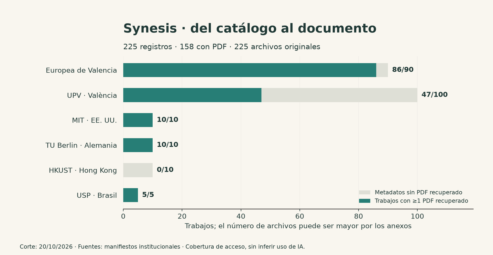
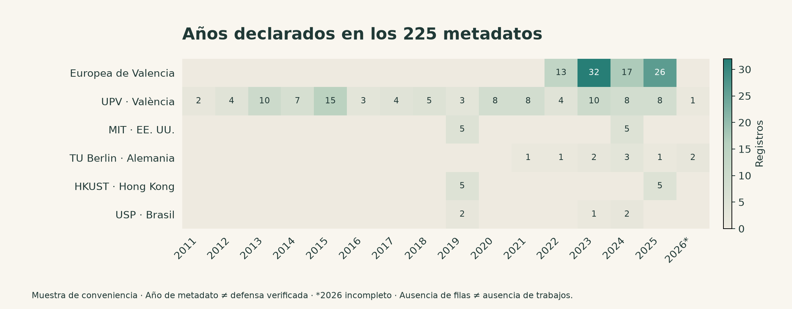
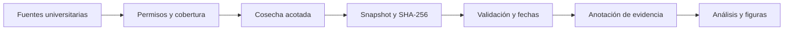

<p align="right"><strong>ES</strong> · <a href="README.en.md">EN</a></p>


# Synesis

**v0.2.0 · 225 registros · 158 con PDF original · 13.558 páginas y 20.204 fragmentos buscables · [Release v0.2.0](https://github.com/marcosdeaza/Synesis/releases/tag/v0.2.0)**

Investigación reproducible sobre TFG, TFM y equivalentes universitarios alrededor de la difusión de la IA generativa. El foco es Valencia; la **Universidad Europea de Valencia es obligatoria** en el diseño, junto a UPV y comparadores nacionales e internacionales.

Esta distribución publica los **225 registros reales de metadatos de seis fuentes** reunidos en la auditoría inicial de 13 instituciones. La colección está en [`data/research_225/`](data/research_225/): UEV (90), UPV (100), MIT (10), TU Berlin (10), HKUST (10) y USP (5). Es una muestra de conveniencia para investigar fuentes, cobertura y métodos; no estima adopción de IA ni efectos causales.

Los 225 metadatos se publican con el permiso confirmado por el responsable, registrado en [`PERMISSIONS.json`](data/research_225/PERMISSIONS.json), manteniendo las licencias de origen. El snapshot sigue minimizado: sin resúmenes ni campos de autoría o contacto. Desde la v0.2 se añade una **capa de texto completo** (originales, texto por página, fragmentos con procedencia y búsqueda local), descrita abajo. No se ha entrenado ningún modelo con estos trabajos.

| Colección | Registros | Función |
|---|---:|---|
| [`research_225`](data/research_225/) | **225 únicos** | Metadatos publicados según el permiso confirmado por el responsable; archivos de España y comparadores internacionales, procedencia y manifiesto |
| [`pilot/rights_cleared.jsonl`](data/pilot/rights_cleared.jsonl) | **10 de TU Berlin** | Subconjunto con evidencia institucional CC0-1.0 que utiliza el pipeline reproducible |

Los 10 registros del piloto **ya están incluidos entre los 225**: no hay 235 trabajos únicos. Los informes analíticos y las figuras de esta versión se calculan exclusivamente con el piloto de 10; la validación de los 225 tiene un informe separado. [Alcance y publicación](docs/PUBLICACION.md) · [Ficha de los datos](docs/DATASET_CARD.md).

## Texto completo y datasets reutilizables (v0.2)



| Institución | Registros | Con PDF recuperado | Estado de los demás |
|---|---:|---:|---|
| Universidad Europea de Valencia | 90 | **86** | 1 restringido, 1 PDF inválido, 1 no encontrado, 1 error HTTP |
| UPV · València | 100 | **47** (114 archivos con anexos) | 53 con acceso restringido en origen |
| MIT | 10 | **10** | n/a |
| TU Berlin | 10 | **10** | n/a |
| USP | 5 | **5** | n/a |
| HKUST | 10 | 0 | `robots.txt` del repositorio prohíbe el acceso automatizado; no se elude |
| **Total** | **225** | **158** (225 archivos, 2,41 GB) | cada uno de los 225 tiene un estado documentado |

Sobre esos PDFs se construye un corpus local: **13.558 páginas**, **20.204 fragmentos** (nunca cruzan página ni obra) y 22,2 millones de caracteres, con SQLite FTS5 y Parquet. De los 225 documentos, 153 tienen texto extraído, 40 texto parcial y 32 requerirían OCR (no se ha ejecutado OCR ni se finge). Cada fragmento conserva obra, documento, página, offsets, SHA-256 del PDF, URL de origen y licencia observada.

Los PDFs y derivados no están en el historial Git: se descargan de la [release v0.2.0](https://github.com/marcosdeaza/Synesis/releases/tag/v0.2.0) con verificación SHA-256.

```sh
python3 scripts/download_release.py --tag v0.2.0           # metadatos + corpus procesado
python3 scripts/download_release.py --tag v0.2.0 --pdfs    # añade los PDFs originales
python3 scripts/search_corpus.py 'inteligencia artificial' --institution uev --limit 5
```

[Cómo reutilizarlo en otro proyecto](docs/REUTILIZAR.md) · [Ficha del texto completo](docs/FULLTEXT_DATASET_CARD.md) · [Experimentos y particiones](docs/EXPERIMENTOS.md) · [Adquisición en España](docs/ADQUISICION_ESPANA.md) y [global](docs/ADQUISICION_GLOBAL.md) · [Paquetes](docs/PUBLICACION.md).

**Derechos.** Las licencias de origen se conservan por archivo y varían: hay obras CC BY-NC-ND, de derechos reservados o con licencia desconocida. Descargarlas aquí no concede por sí mismo reutilización comercial, entrenamiento ni redistribución de derivados a terceros; ver [RIGHTS.md](RIGHTS.md) y [`data/fulltext/PERMISSIONS.json`](data/fulltext/PERMISSIONS.json). Los originales pueden contener nombres y firmas de autores. Para retirar un documento, abre un issue sin datos sensibles.



## Qué estudia Synesis

Dos líneas separadas: cambios observables en temas, métodos y referencias, y evidencia explícita de uso declarado de IA. Las fechas de lanzamiento describen disponibilidad tecnológica; su relación con las prácticas académicas debe investigarse con cobertura, fechas y anotación verificadas.

## Leer y continuar

- [Protocolo científico](docs/PROTOCOLO.md) y [plan de análisis](docs/PLAN_ANALISIS.md).
- [Fuentes y permisos](docs/FUENTES.md), [auditoría de España](docs/FUENTES_ESPANA.md) y [auditoría internacional](docs/FUENTES_GLOBALES.md).
- [Continuidad de la versión pública](CONTEXTO_PUBLICO.md) y [cronología](docs/CRONOLOGIA.md).
- [Informe reproducido de esta distribución](reports/PILOTO.md) y [derechos por capa](RIGHTS.md).

La memoria completa local no se copia. `CONTEXTO.md` en esta variante enlaza a la continuidad pública documentada arriba.


## Hitos y pipeline




## Reproducir sin red

Python 3.11 o posterior; el pipeline y las pruebas usan únicamente la biblioteca estándar:

```sh
make reproduce
```

`make reproduce` valida los **225 registros completos** mediante `scripts/check_research_snapshot.py` y reconstruye por separado el análisis del piloto de **10 registros** de `data/pilot/rights_cleared.jsonl`. Los resultados se guardan en `reports/`; [`research_225_validation.json`](reports/research_225_validation.json) corresponde a la validación de los 225 y [`manifest.json`](reports/manifest.json) a las diez entradas del análisis. La colección completa tiene su propio [manifiesto](data/research_225/manifest.json). Los fixtures sintéticos de las pruebas comprueban el software y no forman parte del corpus de investigación. Las figuras analíticas usan exclusivamente el piloto de 10; se regeneran instalando el extra opcional `.[figures]` y ejecutando `make figures`.

Una mención de IA no acredita uso. Un año de repositorio no prueba defensa. La evidencia CC0 del piloto de 10 se refiere a esos metadatos; el permiso declarado para la colección de 225 tiene su propio registro y alcance, y la capa de texto completo conserva la licencia observada de cada obra.

Preparación inicial de código y documentación asistida por IA; revisión académica independiente pendiente. No se presentan resultados causales ni estimaciones de adopción. [Cómo contribuir](CONTRIBUTING.md) · [Bibliografía](docs/BIBLIOGRAFIA.bib).
